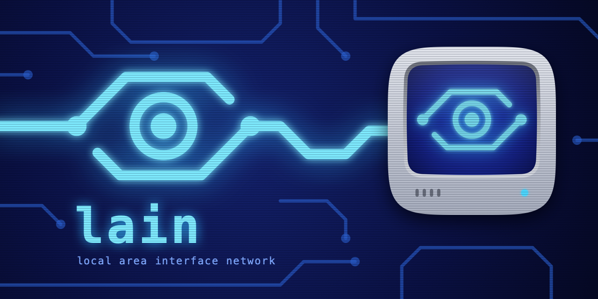

# lain

Use an iPad Pro and its Magic Keyboard as your computer's display, keyboard and trackpad. The computer (the
*host*) streams its screen to the iPad with low latency and takes input back, over a USB-C cable or Wi-Fi on
your local network. A Mac host plays its sound through the iPad too. Hosts run on a Mac or on Linux.

## What you need

- An **iPad Pro** on iPadOS 27, ideally with a Magic Keyboard.
- A host, one of:
  - a **Mac** on macOS 27;
  - a **Linux PC** on Ubuntu 26.04 with GNOME (Wayland) and an AMD GPU.
- A **USB-C cable** for the first connection.

## Get started

1. **Install the host** on your computer: see [Mac](#mac) or [Linux](#linux) below.
2. **Install the iPad app.** It isn't on the App Store yet, so you build it with Xcode on a Mac: see
   [Build the iPad app](#build-the-ipad-app).
3. **Connect them with the cable** and open lain on the iPad. That first connection pairs the iPad with the
   host. After that, Wi-Fi works too; when the cable is plugged in, lain uses it.

On the iPad, **hold the right Option key** to open lain's panel: settings (scroll direction, touch, which
computer and network to use) and the keyboard shortcuts. The right Option key also stands in for Command, so
that shortcuts like ⌘ Tab reach the computer instead of the iPad.

### Without a Magic Keyboard

lain also works with the iPad on its own: touch, an on-screen keyboard and dictation.

- **Touch.** Touching the picture presses the mouse button at that spot and holds it until you lift: tap to
  click, tap twice to double-click, move to drag. Drag with two fingers to scroll, and tap with two fingers to
  right-click. (**Touch screen** in lain's panel turns this off.)
- **Trackpad areas**, for finer control. A finger that starts on one moves the pointer like a trackpad: tap to
  click; to drag, hold still for a moment, then move.
  - Landscape: a faint patch in each bottom corner, under your thumbs.
  - Portrait: the strip between the picture and the keyboard.
- **Dictation.** Tap a microphone button (in landscape, the one at the right edge) and speak; each phrase is
  typed on the computer when you pause, and tapping the microphone again stops. While you speak, the words
  still being heard show in the trackpad (in landscape, low between the thumb patches), and ⌫ and ⏎ keys
  appear (in landscape, above and below the microphone): ⌫ takes back the last phrase, ⏎ presses Return
  and stops dictating. Any Return, the on-screen keyboard's or a hardware keyboard's, also stops it, after
  the last words are typed. Dictation runs on the iPad.
- **Keyboard.** Turn the iPad to portrait and the keyboard comes up under the picture. The rows above it add
  Esc, Tab, arrows and more; ⌃ ⌥ ⌘ apply to the next key (⌃ then C is Control-C). In landscape, touch and
  hold the microphone button and choose **Keyboard**.
- **Settings.** The slider key above the keyboard, or touch and hold the microphone button.

With a Magic Keyboard attached, none of this shows; press Globe twice to dictate.

Typing and dictation need Mac host 0.2 or later; the Linux host doesn't have them yet.

### On an iPhone Duo

The same app runs on an iPhone Duo; it has no trackpad or mouse, so it works as an iPad does without a Magic
Keyboard. The computer's display is the size of the Duo's inner display, open or closed.

- **Open**, it is the iPad's layout: landscape for the display with the thumb trackpad areas and the
  microphone button, portrait for the picture over the keyboard.
- **Half folded like a laptop** and set down, it is for watching something long-running, such as a coding
  agent at work. The picture fills the half above the fold; below it there is no keyboard, but a row of keys
  that answer a prompt (esc, ⌃C, ⇧⇥, ↑, ↓, 1, 2, 3, Return), a large trackpad that works like a Magic
  Trackpad (two fingers scroll, a pinch zooms the picture above) and a large microphone. The trackpad's
  colour says what the picture is doing: grey when nothing is happening, green while it keeps changing, and
  orange, with a chime and a tap, when it has stopped changing (likely waiting for you). Your own touches,
  and the connection dropping, don't count as stopping.
- **Closed** and upright, it is a remote: the display over a large trackpad. The buttons beside the camera
  dictate, bring up the keyboard and open the settings; slide a thumb along the ribbon under them to scroll.
- **Closed** and turned on its side, the display fills the screen, with the thumb trackpad areas and the
  microphone button (touch and hold it for the keyboard and the settings).
- **Pinch** the picture with two fingers to zoom in on part of the display, on either screen (and on an iPad);
  zoomed in, the view follows the pointer. Pinch back out for the whole display.

### Sound

A Mac host (0.2 or later) plays its sound on the iPad, and mutes its own speakers while the iPad is
connected. It is tuned for alerts and speech, not music: about a tenth of a second behind on a steady
connection, and more on Wi-Fi that stalls, where the iPad holds extra sound so that it doesn't stutter.
lain's panel shows the delay under **Sound**. To keep the sound on the Mac, turn off **Play Sound on the
iPad** in lain's menu on the Mac.

## Install a host

Download the host from [Releases](https://github.com/daig/lain/releases).

### Mac

1. Open `lain-mac-host-<version>.dmg`, drag **LainHost** onto **Applications**, and open it. It runs in the
   menu bar (an eye icon).
2. Allow **Screen Recording** and **Local Network** when macOS asks.
3. Give it **Accessibility**, which keyboard and trackpad input need. macOS doesn't ask for this one: choose
   **Grant Accessibility…** in lain's menu, or turn on LainHost in System Settings › Privacy & Security ›
   Accessibility. Without it, the pointer jumps back and typing does nothing.
4. Choose **Start at Login** in lain's menu.

Also turn off **Universal Control**, which otherwise moves your Mac's own mouse and keyboard onto the iPad: on
the Mac in System Settings › Displays › Advanced, and on the iPad in Settings › General › AirPlay & Continuity
› Cursor and Keyboard.

### Linux

```sh
sudo apt install ./lain_<version>_amd64.deb
lain autostart on                  # run as yourself, not root: start lain with your desktop session
systemctl --user start lain-hostd  # start it now (or log out and back in)
```

`lain status` shows whether it's running, and `journalctl --user -u lain-hostd -f` shows its log. Settings
are in `~/.config/lain/config.toml` (an example is in `/usr/share/doc/lain/config.example.toml`).

For Wi-Fi, the iPad and the PC must be on the same network: in lain's panel on the iPad, set **Wi-Fi path** to
**Automatic** or **Network**. (**Direct**, Apple's peer-to-peer Wi-Fi, only works with a Mac.)

## Build the iPad app

You need a Mac with Xcode 27 and an Apple ID. A free Apple ID works, but the app then stops opening after
7 days and has to be installed again.

1. In `project.yml`, set `DEVELOPMENT_TEAM` to your team ID, and set the bundle IDs that start with
   `sub.dev.lain.client` to ones of your own.
2. Run `Scripts/bootstrap.sh`. It generates `lain.xcodeproj` (installing XcodeGen through Homebrew if needed).
3. Open `lain.xcodeproj`, choose the **LainClient** scheme and your iPad, and run.

## Build a host from source

- **Mac:** the **LainHost** scheme in the same project. `Scripts/install-host.sh` builds the working tree,
  installs it in `/Applications` and starts it. It signs with Developer ID, as a release is signed, so it needs
  the team's Developer ID certificate (see `RELEASING.md`).
- **Linux:** the Rust workspace in `rust/`. `rust/dist/install.sh` installs from source, and
  `rust/dist/build-deb.sh` builds the `.deb`.

## License

MIT: see [LICENSE](LICENSE).
